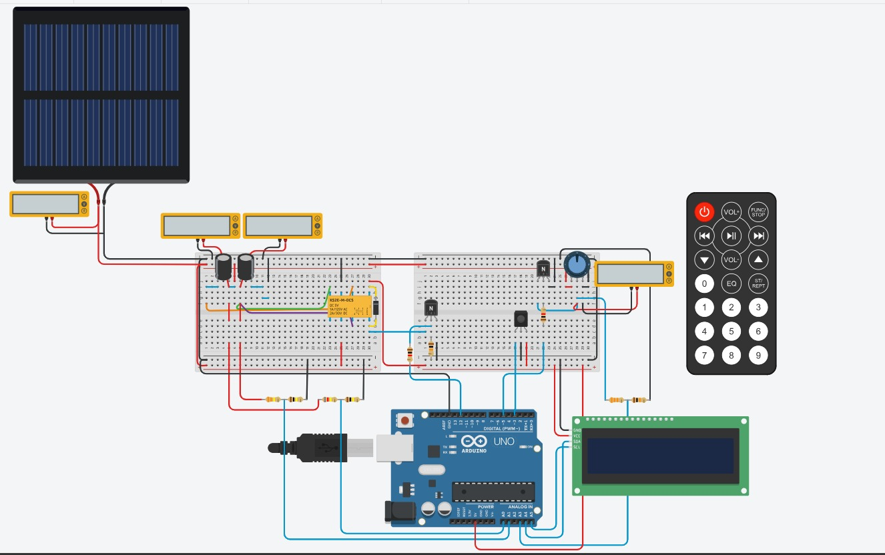
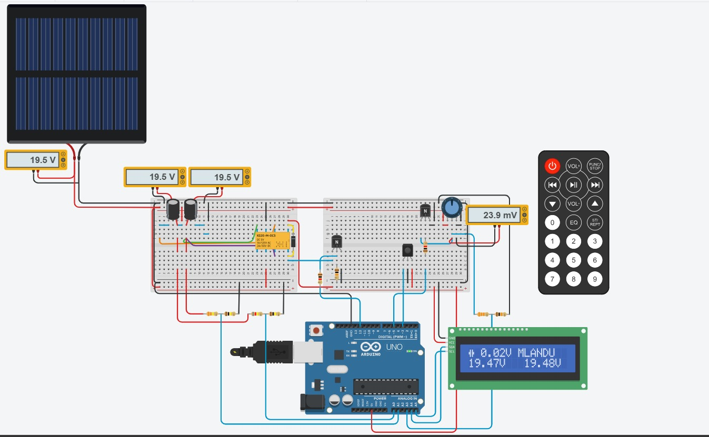
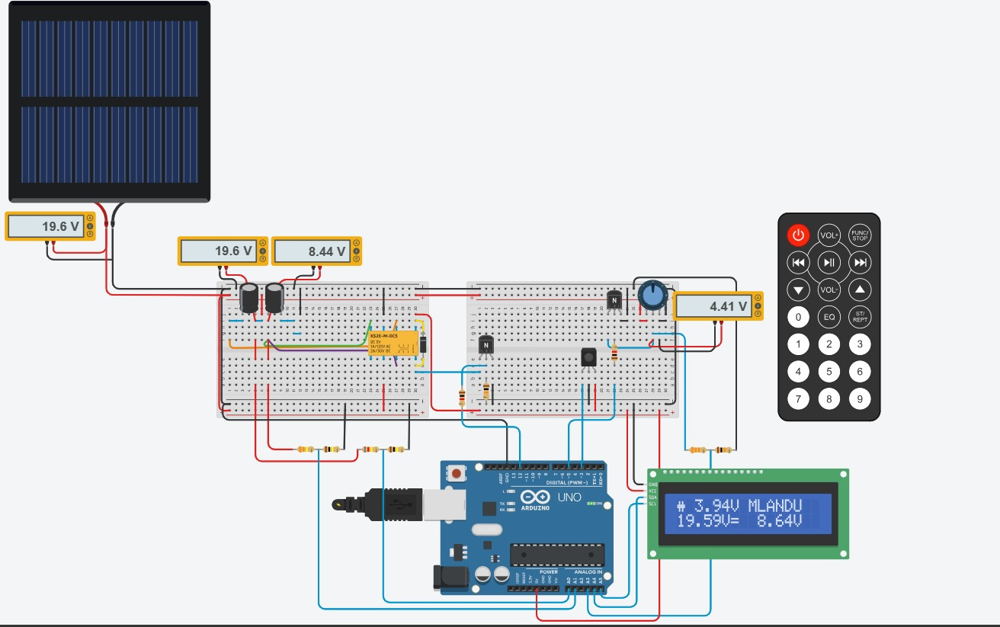

# Solar Capacitor Energy Storage System

An Arduino-based embedded system that uses capacitors as an alternative to batteries in a solar-powered setup. The system automatically switches two capacitors between parallel and series configurations to charge efficiently, while allowing the user to select a target output voltage via an IR remote.

---

## Overview

This project explores using capacitors instead of batteries for short-term solar energy storage. The Arduino controls a relay that switches the capacitors between **parallel mode** (lower voltage, higher capacitance) and **series mode** (higher voltage, lower capacitance), depending on the target output voltage selected by the user.

The user enters a two-digit target voltage on an IR remote (e.g., "4" then "3" for 4.3V). The Arduino:
- Decodes the IR signal and stores the target voltage
- Automatically selects parallel or series mode based on the target
- Reads the actual load voltage through a voltage divider
- Adjusts a PWM signal to regulate the output to match the target
- Displays all readings and the current mode on a 16×2 I2C LCD

---

## How It Works

**Startup — Parallel Mode**
When the circuit powers on, the solar cell charges both capacitors in parallel through the relay's normally-closed (NC) contacts. The LCD shows the parallel-mode icon alongside the load voltage, the user's surname, and both capacitor voltages.

**Setting a Target Voltage**
The user presses a two-digit value on the IR remote — for example, "4" then "3" for 4.3V. The Arduino decodes the IR signal, combines the two digits, and stores 4.3V as the target voltage.

**Switching to Series Mode**
Because 4.3V is above the 3.01V threshold (70% of 4.3V), the Arduino drives pin 12 HIGH. This turns on the relay driver transistor (2N2222), energises the relay coil, and switches the capacitors from parallel to series. The LCD icon changes to the series symbol, and the two capacitor voltages now read differently — one around 19V and the other around 9V — confirming the switch.

**Voltage Regulation via PWM**
The Arduino reads the actual load voltage through the A3 voltage divider and compares it to the 4.3V target. Using a calibrated PWM curve, it calculates the correct PWM value and writes it to pin 5. The PWM drives the base of a second 2N2222 transistor, which controls how much current flows through the collector-emitter path, pulling the load voltage up or down until it matches the target. The LCD updates in real time, and a multimeter across the potentiometer confirms the output settles at approximately 4.53V.

**Returning to Parallel Mode**
If the user selects a value below the 3.01V threshold — such as 2.1V — the relay switches back to parallel mode, the icon changes, the capacitor voltages equalise, and the PWM adjusts to bring the output down to around 2.16V.

This cycle repeats continuously, allowing the user to dynamically control the output voltage while the system automatically selects the most efficient capacitor configuration.

---

## Hardware

| Component | Details |
|---|---|
| Microcontroller | Arduino Uno |
| IR Receiver | IR receiver module (simulated in Tinkercad) |
| Relay | DPDT relay |
| Display | 16×2 I2C LCD |
| PWM Transistor | 2N2222 (NPN) |
| Relay Driver Transistor | 2N2222 (NPN) |
| Solar Cell | 20V |
| Capacitors | 4.5 µF (×2) |
| Other | Voltage dividers, potentiometer (load), resistors, IR remote |

---

## Pin Usage

| Pin | Function |
|---|---|
| Pin 5 | PWM output to load regulation transistor |
| Pin 12 | Relay control (parallel/series switching) |
| A3 | Load voltage sensing (via voltage divider) |
| I2C (SDA/SCL) | 16×2 LCD communication |

---

## Features

- Automatic parallel/series capacitor switching based on target voltage
- IR remote input for setting target voltage (two-digit entry)
- Real-time PWM-based voltage regulation
- Live voltage and mode display on 16×2 I2C LCD
- Voltage threshold logic (70% of target) for mode selection
- Designed and tested in Tinkercad, then verified on physical hardware

---

## Project Images

### Circuit — Powered Off

### Circuit — Parallel Mode

### Circuit — Series Mode

---

## Files

- `Circuit_code.ino` — Arduino source code
- `circuit-off.jpeg` — Photo of the circuit powered off
- `circuit-parallel-mode.jpeg` — Circuit operating in parallel mode
- `circuit-series-mode.jpeg` — Circuit operating in series mode

---

## What I Learned

- Designing and testing an embedded system that integrates sensing, control and user input
- Working with IR remote decoding and multi-digit input handling
- Using relays to reconfigure capacitor topology at runtime
- Implementing PWM-based voltage regulation with a calibrated output curve
- Interfacing an I2C LCD and voltage dividers with an Arduino
- Moving from simulation in Tinkercad to real hardware testing

---

## Future Improvements

- Replace the solar cell with a proper regulated input to test broader voltage ranges
- Add over-voltage and over-current protection
- Log voltage data over time (SD card or serial output)
- Add a battery backup for continuous operation
- Move the control logic to an ESP32 for Wi-Fi monitoring

---

## Author

**Mivuyo Mlandu**
BEngTech Computer Engineering — Cape Peninsula University of Technology (CPUT)

- LinkedIn: [mivuyo-mlandu](https://www.linkedin.com/in/mivuyo-mlandu)
- Email: mlandumivuyo01@gmail.com
